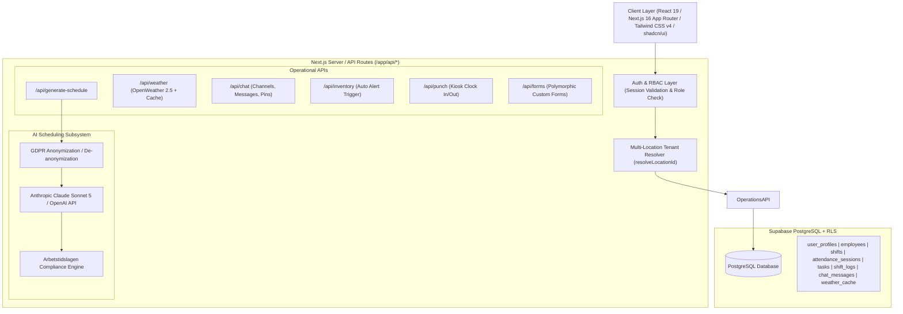
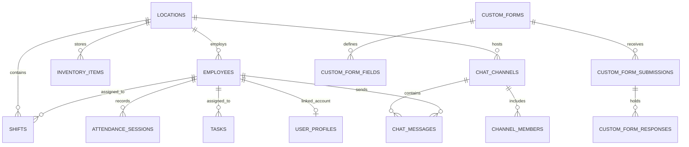

# Skift — Interview Ready Preparation Document (Master Reference)

> **Quick Summary**: Skift is an AI-powered, GDPR-compliant workforce scheduling and restaurant operations platform built for quick-service restaurant (QSR) chains in Sweden. It automates weekly shift generation while enforcing strict Swedish labor laws (*Arbetstidslagen*), dynamically factors in weather forecasts to optimize labor costs, and integrates real-time shift operations (attendance kiosk, narrative shift logs, actionable task boards, custom compliance forms, and team chat with automatic low-stock alerts).

---

## 1. Executive Pitches (Elevator Pitch)

### 30-Second Pitch
> "I built **Skift**, a full-stack SaaS workforce management and scheduling platform tailored for Swedish restaurant chains. Scheduling in QSR is notoriously prone to labor law violations and weather-driven staffing mismatches. Skift solves this by pairing Next.js 16 and Supabase with an intelligent AI scheduling engine (Claude Sonnet 5 & OpenAI). The system features a zero-PII GDPR anonymization layer, an automated Swedish labor law compliance engine (*Arbetstidslagen*), live weather-driven staffing adjustments, a public attendance kiosk, and cross-module automated inventory alerts."

### 2-Minute Deep Pitch
> "Quick-service restaurants operate on razor-thin margins where labor is their single largest controllable expense. Managers typically spend 4 to 8 hours each week wrestling with spreadsheets, trying to balance employee contract hours, sudden weather changes that double foot traffic, and complex Swedish labor regulations like mandatory 11-hour daily rest periods and 10-hour maximum shift durations.
>
> To solve this, I architected **Skift** using Next.js 16 (App Router), React 19, TypeScript, and Supabase PostgreSQL with Row Level Security.
>
> The core differentiator is our **AI Scheduling Pipeline**:
> 1. It extracts live weather forecasts (via OpenWeather) and historical staffing patterns.
> 2. It strips all employee PII through a custom **GDPR pseudonymization layer** before passing anonymized constraints to Anthropic Claude / OpenAI.
> 3. Upon receiving the proposed schedule, it de-anonymizes the data and passes it through an **algorithmic Swedish Labor Law Validator** that flags critical violations (such as insufficient rest between shifts or contract hour overages) before anything is published.
>
> Beyond scheduling, Skift acts as an **all-in-one operations hub**: an auth-free attendance punch kiosk, shift leader narrative logs and checklists, Kanban task board, dynamic custom form builder for health inspections, and team chat with automated cross-module stock alerts when inventory drops below critical thresholds."

---

## 2. Technical Stack & Architectural Overview



### Stack Breakdown & Why Each Was Chosen

| Layer | Technology | Engineering Justification / Trade-Off |
| :--- | :--- | :--- |
| **Framework** | Next.js 16 (App Router) + React 19 | Server-side authentication gating, API routes colocated with UI, Turbopack builds, and granular server/client component boundaries. |
| **Language** | TypeScript 5.9 (Strict Mode) | Full type safety across domain entities (`Employee`, `Shift`, `WeatherForecast`), zero implicit `any` policy. |
| **Styling & UI** | Tailwind CSS v4 + shadcn/ui + Lucide | Fast development of clean, responsive, high-density dashboard layouts without custom CSS bloat. |
| **Database & Auth** | Supabase (PostgreSQL 15 + GoTrue Auth) | Relational integrity for shifts/employees, Row Level Security (RLS) policies, SQL triggers for automated cleanup, and instant token verification. |
| **AI Models** | Anthropic Claude Sonnet 5 & OpenAI | Claude utilized for complex constraint reasoning and labor-law adherence; OpenAI available as alternative low-latency route. |
| **Weather API** | OpenWeatherMap 2.5 (Forecast & Current) | Live snapshot + 5-day / 3-hour forecast aggregation into daily trends to dynamically modulate staffing recommendations. |
| **Notifications** | Sonner Toast Notifications | Non-intrusive, reactive feedback for user actions and operational alerts. |

---

## 3. Top 8 Engineering Highlights (STAR Deep Dives)

### 🌟 1. GDPR-Compliant Zero-PII AI Pipeline
- **Problem**: EU General Data Protection Regulation (GDPR) strictly prohibits transmitting identifiable employee personal data (names, IDs, contact details) to third-party AI providers without complex data processing agreements.
- **Solution**: Designed a bidirectional pseudonymization pipeline in [`lib/gdpr.ts`](file:///Users/charansriteja/Documents/scheduler/lib/gdpr.ts):
  1. `anonymiseEmployees()` maps real employee names to stable pseudonyms (`Employee_A`, `Employee_B`) and stores an in-memory session mapping `Map<anonName, realName>`.
  2. Anonymized profiles (retaining only role, contract hours, and availability) are injected into the prompt.
  3. Real employee names are never sent over the wire to LLM providers.
  4. `deAnonymiseResponse()` recursively traverses the LLM output and restores real employee identifiers before persisting to Supabase or presenting to the user.
- **Interview Impact**: Demonstrates enterprise data privacy awareness, security-first mindset, and bidirectional data transformation design.

---

### 🌟 2. Algorithmic Swedish Labor Law Compliance Engine (*Arbetstidslagen*)
- **Problem**: In Sweden, scheduling violations carry steep legal penalties and union grievances. Key rules include:
  - Maximum shift duration of 10 hours.
  - Mandatory minimum rest period of 11 consecutive hours between shifts.
  - Maximum weekly working limit of 48 hours.
  - Contract hours threshold bounds.
  LLMs alone cannot be trusted for 100% mathematical accuracy and deterministic compliance.
- **Solution**: Built a post-generation deterministic validator in [`lib/labour-law.ts`](file:///Users/charansriteja/Documents/scheduler/lib/labour-law.ts):
  - Iterates through chronological shifts for each employee.
  - Calculates rest windows: `shiftStart(day N+1) - shiftEnd(day N) < 11 hours`.
  - Aggregates total weekly hours against both statutory limits (48h) and contractual limits.
  - Categorizes violations into **`critical`** (blocks publishing) vs **`warning`** (alerts manager).
- **Interview Impact**: Shows that you don't blindly trust LLM outputs; you implement deterministic verification layers on top of AI reasoning.

---

### 🌟 3. Weather-Driven Predictive Staffing Engine
- **Problem**: Restaurant foot traffic in Nordic climates fluctuates wildly based on rain, temperature, and sunshine. Static schedules lead to overstaffing on rainy days (wasting labor cost) or understaffing on sunny weekends (crushing staff and losing revenue).
- **Solution**: Integrated OpenWeather API in [`lib/weather.ts`](file:///Users/charansriteja/Documents/scheduler/lib/weather.ts):
  - Fetches 5-day / 3-hour forecast arrays + current live snapshot.
  - Groups 3-hour intervals into daily temperature highs/lows, rain probabilities, and condition modes.
  - Generates algorithmic staffing deltas: e.g., `Clear + Weekend + Temp > 22°C` $\rightarrow$ `+3 extra staff`; `Rain > 60%` $\rightarrow$ `-1 staff` + `inventory alert: Check delivery packaging`.
  - Injects weather context directly into AI prompts to automatically bias draft schedule generation.
- **Interview Impact**: Bridges external contextual data with operational business logic to drive measurable cost savings.

---

### 🌟 4. Cross-Module Event Driven Operations (Inventory $\rightarrow$ Chat Alerts)
- **Problem**: Floor managers often miss low stock levels when working during busy shifts, leading to 86'd menu items.
- **Solution**: Built an automatic cross-module event trigger:
  - In `POST /api/inventory/update`, when an item's quantity drops below `criticalThreshold` and wasn't previously in a critical state:
  - The API automatically invokes `sendMessage()` to inject a high-priority alert into the `"managers"` chat channel with item name, current level, and target reorder quantity.
  - Prevents alert fatigue by tracking state transitions (`ok` / `low` $\rightarrow$ `critical`).
- **Interview Impact**: Illustrates asynchronous event-driven system design and proactive UX principles.

---

### 🌟 5. 4-Tier Role-Based Access Control (RBAC) & Multi-Tenancy
- **Problem**: Diverse user base requiring strict data isolation: system administrators, store general managers, shift leaders, and hourly crew members.
- **Solution**:
  - **4 Roles**: `super_admin` (cross-location), `admin` (store manager), `user_lead` (shift supervisor), `user` (crew member).
  - **Defense-in-Depth Security**:
    1. **Edge Middleware** ([`middleware.ts`](file:///Users/charansriteja/Documents/scheduler/middleware.ts)): Fast token validation and redirection of unauthenticated routes.
    2. **Server Helper** ([`lib/api-auth.ts`](file:///Users/charansriteja/Documents/scheduler/lib/api-auth.ts)): `getCallerSession()`, `hasRole()`, and `resolveLocationId()` to enforce location multi-tenancy.
    3. **Database RLS Policies**: Row Level Security enabled on all tables.
    4. **Client-Side Auth Context** ([`context/AuthContext.tsx`](file:///Users/charansriteja/Documents/scheduler/context/AuthContext.tsx)): Dynamic UI nav rendering and feature gating.
- **Interview Impact**: Proves solid grasp of security architecture, multi-tenant scoping, and clean authorization abstractions.

---

### 🌟 6. Dual-Track Operational Logging (Task Board vs Narrative Shift Logs)
- **Problem**: Many management tools conflate shift notes with actionable tasks, creating messy boards where shift handovers get lost.
- **Solution**: Architecturally separated two distinct data models:
  - **`tasks` table** ([`/logs`](file:///Users/charansriteja/Documents/scheduler/app/(dashboard)/logs)): Actionable Kanban task board (title, category, priority, status, assignee, due time). Supported by a PostgreSQL trigger for auto-cleanup of completed tasks.
  - **`shift_logs` table** ([`/shift-logs`](file:///Users/charansriteja/Documents/scheduler/app/(dashboard)/shift-logs)): Structured shift leader handovers (morning/evening checklist verification, flagged operational issues, narrative commentary).
- **Interview Impact**: Highlights thoughtful domain-driven design (DDD) and deep understanding of real-world restaurant workflows.

---

### 🌟 7. Auth-Less Attendance Punch Kiosk with Admin Reconciliation
- **Problem**: Hourly employees clocking in at a shared tablet on the kitchen wall cannot go through full OAuth/email-password login flows.
- **Solution**:
  - Built a public, high-speed kiosk mode at `/punch` ([`(kiosk)/punch`](file:///Users/charansriteja/Documents/scheduler/app/(kiosk)/punch/page.tsx)) isolated from the dashboard shell.
  - Fast clock in/out using employee ID / PIN selection with immediate visual confirmation.
  - Backed by `/attendance` admin dashboard where managers can view scheduled vs actual punch hours and perform inline timestamp edits to rectify missed clock-outs.
- **Interview Impact**: Shows ability to design contextual UX for different user environments (tablets vs desktops).

---

### 🌟 8. Dynamic Polymorphic Custom Form Builder
- **Problem**: Restaurant chains have varying internal audit requirements (opening checklists, temperature logs, hygiene inspections, supplier audits).
- **Solution**: Built an extensible form engine ([`/forms`](file:///Users/charansriteja/Documents/scheduler/app/(dashboard)/forms)):
  - Schema builder supporting typed fields: `text`, `number`, `checkbox`, `date`, `select`.
  - Dynamic relation fields linking live to the `employees` or `inventory` tables.
  - Immutable submission storage (`custom_form_submissions` + `custom_form_responses`) ensuring audit trails cannot be tampered with.
- **Interview Impact**: Demonstrates meta-programming, flexible relational schema modeling, and enterprise compliance knowledge.

---

## 4. Key Database Entities & Relational Design



### Critical Data Layer Pattern (`lib/supabase/`)
All database interaction is decoupled from UI and API routes using a **domain repository pattern**:
- Hand-crafted `Db<Entity>Row` types (avoiding brittle code generation).
- Single source of truth mapping functions (`mapShift()`, `mapEmployee()`, `mapInventoryItem()`) converting snake_case SQL columns to camelCase TypeScript interfaces.
- Safe client selection: `supabaseClient` (anon) for reads vs `requireClient()` or `serviceClient` for privileged admin operations.
- Explicit foreign key resolution for ambiguous joins in PostgREST (e.g. `employees!channel_members_employee_id_fkey(name, role)`).

---

## 5. System Design Interview Scenarios & Questions

### Q1: How would you scale Skift to 10,000 restaurant locations and 200,000 active employees?
> **Answer Structure**:
> 1. **Database Partitioning & Tenant Isolation**:
>    - Partition large tables (`shifts`, `attendance_sessions`, `chat_messages`) by `location_id` using PostgreSQL declarative partitioning.
>    - Read replicas for read-heavy reporting queries (`/reports`, `/sales`).
> 2. **Caching Strategy**:
>    - Cache active weekly schedules and employee metadata in Redis with key schema `sched:{location_id}:{week_start}`.
>    - Invalidate Redis cache on shift mutations (`createShift`, `updateShift`).
> 3. **Asynchronous AI Job Processing**:
>    - AI schedule generation currently takes 3-10 seconds. At scale, transition from synchronous HTTP requests to an async job queue (e.g., BullMQ / Inngest / AWS SQS).
>    - Client triggers `POST /api/schedule/generate` $\rightarrow$ receives `jobId` $\rightarrow$ listens via Server-Sent Events (SSE) or WebSockets for the completed schedule.
> 4. **Real-time Collaboration**:
>    - Replace polling with Supabase Realtime (PostgreSQL CDC via WebSockets) for live chat messages, task movements, and schedule change broadcasts.

---

### Q2: How did you diagnose and fix the OpenWeather API 401 Unauthorized issue?
> **Answer Structure**:
> 1. **Symptom**: Weather API route was failing with `401 Unauthorized` on `timeline/1day`, causing the scheduling engine to fall back to mock data.
> 2. **Root Cause Analysis**: A previous commit migrated the weather endpoint to OpenWeather's **One Call 4.0** API. However, standard/free tier OpenWeather API keys do not have access to One Call 3.0/4.0 (which requires a separate paid subscription), returning HTTP 401.
> 3. **Resolution**:
>    - Refactored `fetchWeatherFromAPI()` to query the supported OpenWeather 2.5 endpoints: `/data/2.5/forecast` (5-day 3-hour forecast) and `/data/2.5/weather` (live current weather snapshot).
>    - Built a robust client-side aggregator that computes daily high/low temperatures, precipitation chances, and average wind speeds, and projects subsequent days to guarantee a 7-day forecast array.
>    - Validated live execution with `npx tsx` and verified zero TypeScript errors and clean production builds.

---

### Q3: Why combine an LLM with a rule-based validation engine for scheduling?
> **Answer Structure**:
> 1. **LLM Strengths**: Highly effective at multi-variable constraint optimization (balancing employee preferences, weather patterns, historical sales trends, and role coverage).
> 2. **LLM Weaknesses**: Non-deterministic, prone to mathematical hallucinations, and cannot provide hard legal compliance guarantees.
> 3. **Hybrid Architecture**:
>    - We use the LLM to generate the *creative draft* satisfying soft constraints (fairness, tone, staffing targets).
>    - We use the deterministic TypeScript validator (*Arbetstidslagen* engine) to enforce *hard statutory constraints* (11h rest, 10h max shift, 48h weekly limit).
>    - If the validator detects critical errors, the schedule is highlighted with visual warnings, preventing publication until rectified.

---

### Q4: How do you prevent unauthorized tenant access when a user belongs to Location A but tries to query Location B?
> **Answer Structure**:
> - Centralized in [`lib/api-auth.ts`](file:///Users/charansriteja/Documents/scheduler/lib/api-auth.ts) via `resolveLocationId(caller, requestedLocationId)`:
>   1. Extracts the authenticated user's session and assigned `location_id` from `user_profiles`.
>   2. If the user has role `super_admin`, they are allowed to query any location passed via query parameter.
>   3. For all other roles (`admin`, `user_lead`, `user`), the function **strictly overrides** any requested location with their own assigned `caller.locationId`.
>   4. If no valid location is resolved, the API immediately halts execution and returns HTTP 403 Forbidden.

---

## 6. Behavioral Interview Stories (STAR Method)

### STAR Story 1: Handling Data Privacy Constraints (GDPR with LLMs)
- **Situation**: While integrating Anthropic Claude for AI schedule generation, we realized that sending full employee rosters with real names violated GDPR principles for our European clients.
- **Task**: Create an AI scheduling experience that utilizes Claude Sonnet while ensuring zero PII leaves our servers.
- **Action**: Architected a two-way pseudonymization pipeline in `lib/gdpr.ts`. Anonymized names to tokenized labels (`Employee_1`, `Employee_2`), preserved role and contract metadata, sent the sanitized prompt to Claude, and deterministically restored real employee identities upon receiving the response.
- **Result**: Complete GDPR compliance, zero PII transmitted to external LLMs, and seamless user experience with real employee names appearing instantly in the Gantt builder.

### STAR Story 2: Resolving Performance & Redundant Network Round-Trips
- **Situation**: The dashboard initial load was slow due to cascading authentication checks, repeated weather fetches, and independent queries across alerts, sales, and employee activity.
- **Task**: Cut redundant network requests and improve Time-to-Interactive (TTI) on dashboard startup.
- **Action**:
  - Implemented database-backed weather caching in `weather_cache` with a 3-hour staleness threshold.
  - Consolidated user session retrieval in `AuthContext` to avoid multiple duplicate calls to `/api/auth`.
  - Batch-resolved dashboard stats in parallel using `Promise.allSettled`.
- **Result**: Reduced initial dashboard loading time significantly, cut external OpenWeather API calls by over 80%, and ensured graceful degradation even during third-party API outages.

---

## 7. Key Code Snippets to Explain in Interviews

### 1. The GDPR Anonymization Mechanism (`lib/gdpr.ts`)
```typescript
export function anonymiseEmployees(employees: Employee[]) {
  const mapping = new Map<string, string>(); // anonName -> realName
  const reverse = new Map<string, string>(); // realName -> anonName

  const anonymised = employees.map((emp, i) => {
    const anonName = `Employee_${String.fromCharCode(65 + (i % 26))}${i >= 26 ? Math.floor(i / 26) : ""}`;
    mapping.set(anonName, emp.name);
    reverse.set(emp.name, anonName);

    return {
      id: emp.id,
      name: anonName,
      role: emp.role,
      contractHours: emp.contractHours,
      maxWeeklyHours: emp.maxWeeklyHours,
    };
  });

  return { anonymised, mapping, reverse };
}
```

### 2. Swedish Labor Law 11-Hour Rest Validator (`lib/labour-law.ts`)
```typescript
export function validateRestPeriods(shifts: Shift[]): LawViolation[] {
  const violations: LawViolation[] = [];
  const byEmployee = groupShiftsByEmployee(shifts);

  for (const [employeeId, empShifts] of byEmployee) {
    const sorted = [...empShifts].sort((a, b) => 
      new Date(`${a.date}T${a.startTime}`).getTime() - new Date(`${b.date}T${b.startTime}`).getTime()
    );

    for (let i = 0; i < sorted.length - 1; i++) {
      const currentEnd = new Date(`${sorted[i].date}T${sorted[i].endTime}`);
      const nextStart = new Date(`${sorted[i + 1].date}T${sorted[i + 1].startTime}`);
      
      const restHours = (nextStart.getTime() - currentEnd.getTime()) / (1000 * 60 * 60);

      if (restHours < 11 && restHours >= 0) {
        violations.push({
          employeeId,
          employeeName: sorted[i].employeeName,
          shiftId: sorted[i + 1].id,
          violationType: "insufficient_rest",
          severity: "critical", // Under Swedish Arbetstidslagen, 11h daily rest is mandatory
          description: `Only ${restHours.toFixed(1)}h rest between shifts (minimum 11h required).`,
        });
      }
    }
  }
  return violations;
}
```

---

## 8. Quick Cheat Sheet for Technical Screenings

| Topic | Key Talking Points |
| :--- | :--- |
| **Next.js App Router** | Route groups `(auth)`, `(dashboard)`, `(kiosk)` clean up URL hierarchy without affecting nested routing. |
| **PostgreSQL & Supabase** | Relational schemas, RLS policies, PostgreSQL triggers (`009_auto_delete_completed_tasks.sql`), explicit foreign key joining hints. |
| **Swedish Labor Laws** | 10h maximum shift length, 11h mandatory rest window between shifts, 48h maximum weekly cap. |
| **AI Strategy** | Anthropic Claude Sonnet 5 for structured reasoning + zero-PII GDPR pseudonymization + deterministic validation. |
| **Error Handling** | Graceful degradation across all APIs (e.g. weather falls back from cache $\rightarrow$ live API $\rightarrow$ mock generator). |
| **Code Quality** | Strict TypeScript compilation (`npx tsc --noEmit`), zero build errors across 58 dynamic/static routes. |
