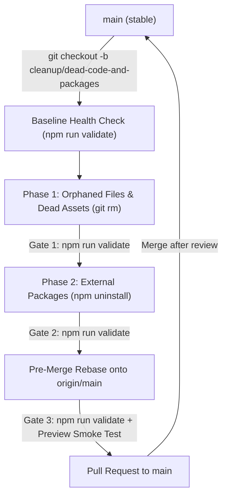
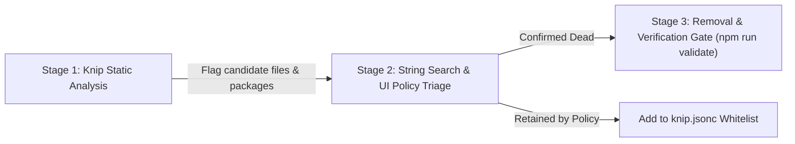

# Dead Code and Unused Package Removal

* **Author:** Charan Sri Teja
* **Status:** Ready for Implementation
* **Date:** 2026-11-14

---

## Overview

Unused external packages and unreferenced components in this Next.js 16 and Supabase application increase bundle size, install times, and maintenance overhead. This design defines a 2-phase pruning strategy executed on a dedicated branch (`cleanup/dead-code-and-packages`), validating each phase against type-checking, linting, Next.js build compilation, and unit tests.

---

## Problem Statement

Removing unused code and packages in a Next.js App Router project introduces three distinct failure modes:

1. **Static Analysis Blind Spots & Framework Entry Points:** Conventions such as `page.tsx`, `layout.tsx`, `route.ts`, `error.tsx`, `loading.tsx`, `middleware.ts`, and build configs (`next.config.ts`, `postcss.config.mjs`, `components.json`) are entry points resolved by runtime file conventions or external build runners. Static analysis tools that scan only import graphs will flag them as unreferenced.
2. **Hidden Runtime and Configuration Dependencies:** Libraries such as `@tailwindcss/postcss` and `tw-animate-css` are referenced via config files or CSS `@import` rules rather than standard ESM imports. Conversely, unreferenced legacy devDependencies such as `autoprefixer` can linger undetected because Tailwind CSS v4 handles vendor prefixing natively.
3. **Branch Divergence and Integration Conflicts:** Modifying dependency manifests and deleting shared files directly on `main` creates merge conflicts and risks shipping unverified breakages into release pipelines.

---

## Goals

* **Isolate Changes:** Execute all cleanup activities on branch `cleanup/dead-code-and-packages` to isolate deletions from `main` until verification completes.
* **Remove Orphaned Files and Assets (Phase 1):** Identify and delete unreferenced custom components, dead utility helpers, obsolete tests, and unused static assets.
* **Prune Unused Packages (Phase 2):** Audit and remove unreferenced `dependencies` and `devDependencies` from `package.json` (such as legacy `autoprefixer`).
* **Build-Verified Gating:** Enforce strict verification gates (`npx tsc --noEmit`, `npm run lint`, `npm run build`, and `npm test`) at every step before committing any removal.
* **Continuous Hygiene:** Retain `knip.jsonc` permanently in the repository and add `"audit:deadcode": "knip"` to `package.json` to prevent recurrent dead-code accumulation.
* **Audit Trail:** Document the technical rationale for each removed package and file.

---

## Non-Goals

* **No Dependency Upgrades:** Upgrading existing packages (e.g., bumping Next.js or React versions) is out of scope.
* **No Business Logic Refactoring:** Active components and utilities will not be rewritten or redesigned during cleanup.
* **No Infrastructure / Schema Changes:** Supabase database schemas, migrations, and remote backend configs are strictly out of scope.
* **No Speculative Internal Pruning (Elimination of Phase 3):** Micro-pruning unreferenced exports or internal helper functions within actively used files is excluded; modern bundlers (Turbopack/Webpack) already tree-shake unreferenced internal exports at build time.
* **No Asset Pipeline Rewriting:** Static assets in `public/` will not be refactored into typed module imports.

---

## Risks & Mitigations

| Failure Mode | Architectural Impact | Mitigation Strategy |
| :--- | :--- | :--- |
| **Runtime-Only Dependencies** | Packages invoked via dynamic reflection or runtime cookies (e.g., `@supabase/ssr` or runtime image processors) pass static build checks but fail in production. | Whitelist known runtime packages explicitly in `knip.jsonc`. Mandate staging preview deployment smoke testing prior to PR merge. |
| **Accidental Deletion of shadcn/ui Primitives** | Deleting unreferenced base primitives in `components/ui/` destroys reusable design-system foundations. | Establish an explicit deterministic rule: whitelist all files under `components/ui/**` in `knip.jsonc`. Prune only custom components outside `components/ui/`. |
| **Corruption of Generated Database Contracts** | Pruning unreferenced exports from generated Supabase schema files (`database.types.ts`) corrupts contract integrity. | Whitelist generated Supabase schema files (`**/database.types.ts`, `**/types/supabase.ts`) in `knip.jsonc` ignore rules. |
| **API Route Handler False Positives** | Restricting Knip entry-point patterns to `.tsx` overlooks `.ts` route handlers (`app/api/**/route.ts`), flagging backend endpoints as dead code. | Configure Knip entry-point patterns explicitly to include `{page,layout,loading,error,not-found,route}.{ts,tsx}`. |
| **Concurrent Branch Collisions on `main`** | Active feature branches landing on `main` may import utilities or packages deleted on the cleanup branch. | Mandate a pre-merge synchronization protocol: rebase `cleanup/dead-code-and-packages` onto `origin/main` and re-run all validation gates immediately before PR merge. |
| **Node Version Incompatibility in Verification Gate** | Node's `--experimental-strip-types` requires Node.js >= 22.6.0; execution fails on Node 20 with `bad option`. | Document Node.js >= 22.6.0 as a strict environment prerequisite for running the test runner. |

---

## Critical User Journeys (CUJs)

### CUJ 1: Branch Isolation and Orphaned File Removal (Phase 1)
* **Given**: The repository contains obsolete components or utility helpers from previous iterations.
* **When**: A developer creates branch `cleanup/dead-code-and-packages`, runs baseline verification, scans the codebase using Knip with App Router entry points and UI primitive whitelists enabled, and removes confirmed orphaned files via `git rm`.
* **Then**: The verification suite passes cleanly, confirming that no active page or route depends on the deleted files.

### CUJ 2: Dependency Pruning and Lockfile Regeneration (Phase 2)
* **Given**: Orphaned source files have been pruned, freeing up external packages whose last consumers were deleted.
* **When**: The developer runs `npx knip --dependencies`, validates candidates against string searches (including CSS `@import` rules and `.ts` asset paths), uninstalls confirmed dead packages via `npm uninstall`, and runs the verification suite.
* **Then**: `package.json` and `package-lock.json` are cleanly updated with zero build or test regressions.

### CUJ 3: Pre-Merge Synchronization and PR Staging
* **Given**: Cleanup changes are committed atomically on `cleanup/dead-code-and-packages`.
* **When**: The developer rebases the cleanup branch onto `origin/main`, executes `npm run validate`, and submits a Pull Request documenting all pruned artifacts.
* **Then**: CI checks pass, reviewer smoke tests verify production preview behavior, and the branch merges cleanly without merge conflicts.

---

## Proposed Architecture

### 1. Branching and Isolation Model

To prevent premature changes on `main` and isolate cleanup commits during testing, all operations execute on a dedicated branch with atomic commits per phase:



---

### 2. Detection & Triage Architecture (Hybrid Model)

To identify dependencies and files referenced outside ESM/CJS import graphs, detection combines static analysis with string search and component retention policies:



#### A. Stage 1: Knip Automated Discovery
Knip performs static analysis of import/export graphs using Next.js App Router rules:
* **Entry Point Protection:** Whitelists `app/**/{page,layout,loading,error,not-found,route}.{ts,tsx}`, `middleware.ts`, `next.config.ts`, `postcss.config.mjs`, `eslint.config.mjs`, and test suites (`test/**/*.test.ts`, `tests/*.test.ts`).
* **Deterministic Whitelist Rules:**
  * Base primitives under `components/ui/**` (shadcn primitives) are permanently whitelisted to preserve design-system foundations.
  * Generated Supabase contracts (`**/database.types.ts`, `**/types/supabase.ts`) are permanently whitelisted.
* **Plugin Configuration:** Knip Next.js and PostCSS plugins are active. `tw-animate-css` is tracked via `app/globals.css`.

#### B. Stage 2: String Search & Policy Triage
Every candidate flagged by Knip must pass secondary verification prior to deletion:
1. **Multi-Extension String Search Audit:** Candidate file paths, asset names, and package names are queried via codebase text search (`rg`) across `.ts`, `.tsx`, `.mjs`, and `.css` files to catch:
   * Static assets in `public/` referenced via URL strings in `app/manifest.ts`, `app/layout.tsx`, `next.config.ts`, and `middleware.ts`.
   * Dynamic icon resolutions (e.g., Lucide icon strings passed dynamically).
   * String-based configuration keys or database table names.
2. **Component Boundary Enforcement:** Only custom components outside `components/ui/` with zero references are marked for deletion.

#### C. Stage 3: Build & Test Verification Gate
Deletions are validated by executing compiler, linter, and test suites via a unified script:
```bash
npm run validate
```
This runs `tsc --noEmit`, `eslint`, `next build`, and `node --test`.

---

### 3. Staged 2-Phase Execution Architecture

The execution pipeline follows a top-down dependency cascade:

#### Phase 1: Orphaned Source Files & Dead Assets
* **Scope:** Unreferenced files in `components/` (excluding `components/ui/`), `lib/`, `hooks/`, `app/`, and `public/`.
* **Process:**
  1. Scan for unimported files using `npx knip --files`.
  2. Perform string search triage across `.ts`, `.tsx`, and `.css` files for `public/` assets and dynamic references.
  3. Delete confirmed dead files using `git rm <path>`.
  4. Run `npm run validate`.
  5. Commit: `git commit -m "chore(clean): remove orphaned source files and assets"`.

#### Phase 2: External Package Pruning (`package.json`)
* **Scope:** `dependencies` and `devDependencies` in `package.json`.
* **Process:**
  1. Scan for unreferenced packages using `npx knip --dependencies`. (Because Phase 1 already removed orphaned files, external packages whose only consumers were dead files will now be correctly exposed).
  2. Cross-reference candidates against string mentions in config files, CSS files (`tw-animate-css`), and environment loaders. Identify legacy baggage like `autoprefixer`.
  3. Uninstall candidate packages using `npm uninstall <package>`.
  4. Regenerate `package-lock.json`.
  5. Run `npm run validate`.
  6. Commit: `git commit -m "chore(deps): prune unused dependencies"`.

---

## Alternatives Considered

### Alternative A: Single-Sweep Direct Cleanup on `main`
* **Pros:** Fast to execute in a single commit; no branch management overhead.
* **Cons:** High blast radius. If failures occur, bisecting the offending change is time-consuming. Increases merge conflict frequency and commit noise on `main`.
* **Reason for Rejection:** Cleaning directly on `main` endangers production stability and active feature development. Staged commits on an isolated branch provide safe review and clean rollback points.

### Alternative B: Pure Knip Automated Triage (Direct Deletions)
* **Pros:** Fully automated and fastest to run.
* **Cons:** Produces false-positive deletions for static assets in `public/` referenced by URL strings (``, `manifest.ts`), dynamic icons, and unreferenced `components/ui/` primitives.
* **Reason for Rejection:** Next.js and Tailwind applications rely on string references and framework conventions that pure static AST scanners miss. A hybrid model with secondary string search triage prevents breaking assets and UI libraries.

### Alternative C: Standalone Utilities (`depcheck` + `ts-prune`)
* **Pros:** Mature, widely documented standalone utilities.
* **Cons:** High false-positive rate. `depcheck` flags PostCSS plugins and Supabase helpers as unused. `ts-prune` lacks awareness of Next.js App Router entry points.
* **Reason for Rejection:** Standalone legacy tools require excessive manual filtering and lack native Next.js App Router integration, generating high triage overhead.

### Alternative D: Manual Grep and Line-by-Line Audit
* **Pros:** Requires no external CLI tools or configuration files.
* **Cons:** Labor-intensive, error-prone, and cannot trace transitive dependency graphs.
* **Reason for Rejection:** Manual text search cannot reliably trace deep dependency graphs and is unscalable.

### Alternative E: 3-Phase Execution with Internal Export/Type Pruning
* **Pros:** Maximizes intra-file cleanliness by stripping unneeded `export` keywords.
* **Cons:** High churn, triggers `no-unused-vars` lint errors when stripping `export`, risks corrupting generated Supabase schema files (`database.types.ts`), and causes severe merge conflicts with concurrent feature branches while providing zero runtime bundle benefit (bundlers already tree-shake exports).
* **Reason for Rejection:** Violates YAGNI and Non-Goal 4. Modern bundlers already tree-shake unreferenced internal exports; the merge conflict and contract corruption risks far outweigh the negligible benefit.

---

## Non-Functional Requirements

* **Build-Verified Gating:** Every staged commit must compile cleanly through `npm run validate` with exit code 0.
* **Branch Isolation:** Changes remain isolated on branch `cleanup/dead-code-and-packages` until approved and merged via Pull Request.
* **Traceability & Granular Rollbacks:** Commit history strictly separates orphaned file deletions (Phase 1) from external package removals (Phase 2).
* **Pre-Merge Synchronization:** The cleanup branch must be rebased onto `origin/main` and re-verified prior to merging to prevent landing regressions.
* **Environment Prerequisite:** Node.js >= 22.6.0 (required for native `--experimental-strip-types` test runner).

---

## Detailed Implementation Plan

### Target Files to Create / Modify / Delete

#### 1. `knip.jsonc` (Create - Permanent in repo root)
* **Type / Scope:** Static Analysis Configuration
* **Proposed Changes:** Codify Next.js App Router entry points, PostCSS plugins, and explicit whitelists for UI primitives and Supabase types:

```jsonc
{
  "$schema": "https://unpkg.com/knip@5/schema.json",
  "entry": [
    "app/**/{page,layout,loading,error,not-found,route}.{ts,tsx}",
    "middleware.ts",
    "next.config.ts"
  ],
  "project": [
    "app/**/*.{ts,tsx}",
    "components/**/*.{ts,tsx}",
    "lib/**/*.{ts,tsx}",
    "hooks/**/*.{ts,tsx}"
  ],
  "ignore": [
    "components/ui/**",
    "**/database.types.ts",
    "**/types/supabase.ts"
  ],
  "ignoreDependencies": [
    "tw-animate-css"
  ]
}
```
* **Rationale:** Establishes permanent, reproducible dead-code detection tuned to Next.js App Router conventions and preserves foundational UI primitives.

#### 2. `package.json` (Modify)
* **Type / Scope:** Project Manifest & Dependencies
* **Proposed Changes:**
  * Add unified validation script: `"validate": "tsc --noEmit && npm run lint && npm run build && npm test"`.
  * Add dead-code audit script: `"audit:deadcode": "knip"`.
  * Phase 2: Uninstall confirmed unreferenced devDependency `autoprefixer` via `npm uninstall -D autoprefixer`.
* **Rationale:** Standardizes verification commands, removes dead Tailwind v3 legacy dependency, and integrates dead-code auditing into continuous workflow.

#### 3. `package-lock.json` (Modify)
* **Type / Scope:** Package Lockfile
* **Proposed Changes:** Regenerated automatically by npm upon uninstalling `autoprefixer` in Phase 2.
* **Rationale:** Keeps lockfile in sync with `package.json` to prevent dependency drift.

#### 4. `lib/utils-extra.ts` (Delete)
* **Type / Scope:** Orphaned Helper Module
* **Proposed Changes:** Remove `lib/utils-extra.ts` (verified to have 0 call-sites across `app/`, `components/`, and `lib/`). Clean up its entry in `lib/README.md`.
* **Rationale:** Eliminates dead helper functions (`formatDate`, `getWeekStart`).

#### 5. Boilerplate Static Assets in `public/*` (Delete)
* **Type / Scope:** Unreferenced Boilerplate Static Assets
* **Proposed Changes:** Delete the 5 default create-next-app boilerplate SVG assets (verified to have 0 references across all codebase files):
  * `public/file.svg`
  * `public/globe.svg`
  * `public/next.svg`
  * `public/vercel.svg`
  * `public/window.svg`
* **Rationale:** Eliminates unused template boilerplate assets and reduces static deployment payload.

#### 6. Retained & Whitelisted Components / Packages (Preserve)
* **Type / Scope:** Active Production Code
* **Explicit Whitelist (Do NOT Delete):**
  * All base primitives in `components/ui/**` (shadcn primitives).
  * Custom components (`components/app-shell.tsx`, `components/dashboard-skeleton.tsx`, `components/error-boundary.tsx`, `components/navigation-progress-bar.tsx`, `components/reconnection-banner.tsx`, `components/skift-icon.tsx`, `components/modules/weather-strip.tsx` - all verified actively imported).
  * Brand static assets (`public/favicon.ico`, `public/icon.svg`, `public/images/*` - verified referenced in `manifest.ts`, `layout.tsx`, and views).
  * Packages `@tailwindcss/postcss` and `tw-animate-css` (verified loaded via PostCSS and CSS `@import`).

---

### Step-by-Step Execution Sequence

#### Step 1: Branch Isolation & Baseline Health Check
1. Verify workspace is clean:
   ```bash
   git status
   ```
2. Verify Node.js version is >= 22.6.0:
   ```bash
   node -v
   ```
3. Create and checkout dedicated branch:
   ```bash
   git checkout -b cleanup/dead-code-and-packages
   ```
4. Add validation scripts to `package.json`:
   ```json
   "validate": "tsc --noEmit && npm run lint && npm run build && npm test",
   "audit:deadcode": "knip"
   ```
5. Run baseline verification:
   ```bash
   npm run validate
   ```
   Confirm all baseline checks pass with exit code 0 before making changes.

#### Step 2: Establish Permanent Knip Configuration
1. Create `knip.jsonc` in the repository root with the schema, entry points, and whitelist rules defined above.
2. Commit configuration:
   ```bash
   git add knip.jsonc package.json
   git commit -m "chore(tooling): add knip dead-code configuration and validate script"
   ```

#### Step 3: Phase 1 - Orphaned File & Asset Removal
1. Delete confirmed unreferenced source helper and boilerplate static assets:
   ```bash
   git rm lib/utils-extra.ts public/file.svg public/globe.svg public/next.svg public/vercel.svg public/window.svg
   ```
2. Update `lib/README.md` to remove the references to `utils-extra.ts`.
3. Execute verification gate:
   ```bash
   npm run validate
   ```
4. Commit changes:
   ```bash
   git commit -m "chore(clean): remove unreferenced utils-extra helper and default boilerplate assets"
   ```

#### Step 4: Phase 2 - External Package Pruning
1. Uninstall confirmed unreferenced package `autoprefixer`:
   ```bash
   npm uninstall -D autoprefixer
   ```
2. Run dead-code audit to verify 0 remaining unreferenced packages:
   ```bash
   npm run audit:deadcode -- --dependencies
   ```
3. Execute verification gate:
   ```bash
   npm run validate
   ```
4. Commit changes:
   ```bash
   git commit -m "chore(deps): remove unreferenced autoprefixer dependency"
   ```

#### Step 5: Pre-Merge Synchronization & PR Staging
1. Fetch latest changes from `origin/main` and rebase:
   ```bash
   git fetch origin main
   git rebase origin/main
   ```
2. Re-run verification suite on the rebased branch:
   ```bash
   npm run validate
   ```
3. Push branch to remote:
   ```bash
   git push -u origin cleanup/dead-code-and-packages
   ```
4. Open Pull Request targeting `main`, including the list of deleted files/packages, verification test output, and deployment preview smoke test results.

---

## Verification Plan

Every phase and step must satisfy the following verification suite prior to commit:

* **TypeScript Compilation:** `npx tsc --noEmit` must return exit code 0 with zero type errors.
* **Linting:** `npm run lint` must return exit code 0 with zero lint errors or warnings.
* **Production Build:** `npm run build` (`next build`) must compile all server and client bundles, static pages, and dynamic route handlers with exit code 0.
* **Test Suite:** `npm test` (`node --experimental-strip-types --test test/**/*.test.ts tests/*.test.ts`) must execute all test files with 100% passing test assertions (requires Node.js >= 22.6.0).
* **Deployment Preview Smoke Test:** Verify client rendering, navigation, and API health endpoints (`/api/health/ping`) on the Vercel preview deployment prior to merging the PR.
